# Лабораторная работа №6

**Тема:** Система контроля версий Git.

**Выполнил:** Дудкин К.Р., группа 4515.

**Дата:** 07.11.2026.

Исходный репозиторий: [Kurtyanik/LR6](https://github.com/Kurtyanik/LR6).

Мой репозиторий: [Kirill866/LR6](https://github.com/Kirill866/LR6).

Ветка с отчётом: [report](https://github.com/Kirill866/LR6/tree/report).

## Цель работы

Научиться работать с Git: просматривать историю, создавать коммиты,
сливать ветки и исправлять конфликты. Работу выполнял в Git Bash,
файлы редактировал в Блокноте.

## Ход работы

### 1. Подготовка

Сделал форк репозитория преподавателя и установил Git.
Настроил имя автора `4515 Дудкин К.Р.` и электронную почту.

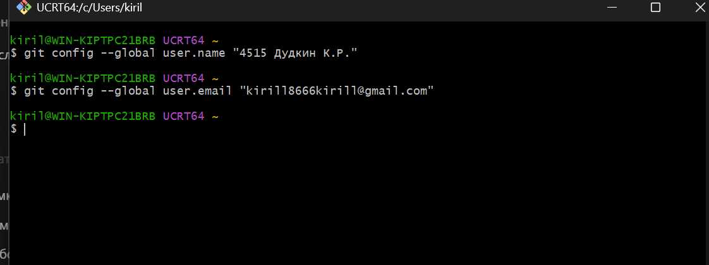

Склонировал свой репозиторий командой
`git clone https://github.com/Kirill866/LR6.git` и перешёл в папку `LR6`.

### 2. Изменение через GitHub

На GitHub создал файл `test.txt` со строкой «Создан через GitHub».
Затем выполнил `git pull`, чтобы получить изменения на компьютере.

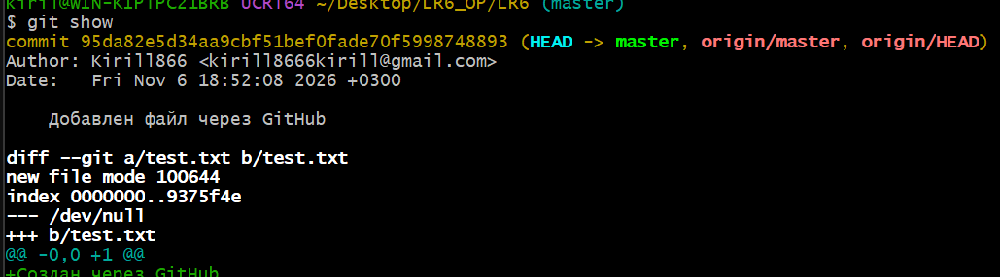

### 3. Ветки и история

Выполнил `git branch -a`. В репозитории были ветки `master` и `branch1`.

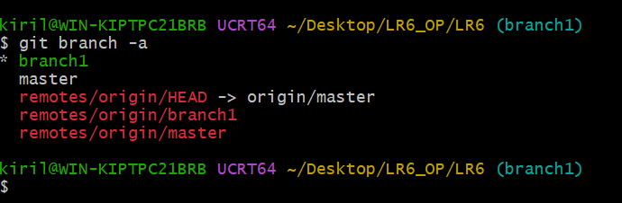

Посмотрел общий граф командой `git log --all --graph --oneline`.

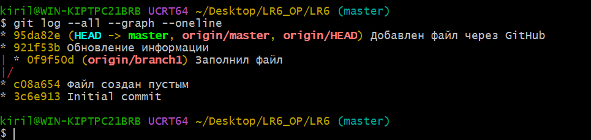

Командой `git log --oneline branch1` посмотрел историю `branch1` — три коммита.

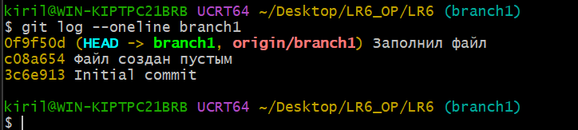

Через `git log --oneline master` посмотрел историю `master` — четыре коммита.

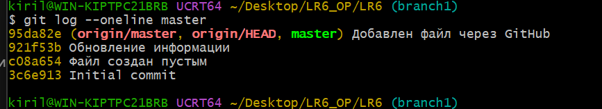

### 4. Последние изменения

Выполнил `git show master`. В последнем коммите был добавлен `test.txt`.
В выводе видно содержимое новой строки со знаком `+`.

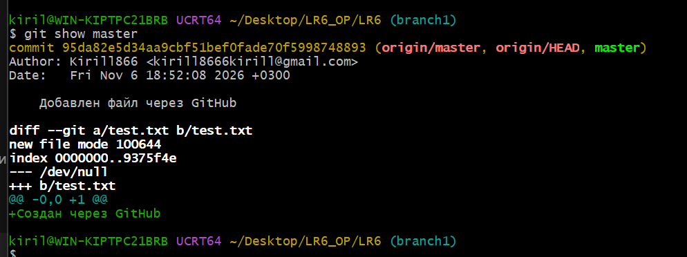

### 5. Слияние и конфликт

Переключился на `master` и выполнил `git merge branch1`.
Возник конфликт в файле `mergefile.txt`.

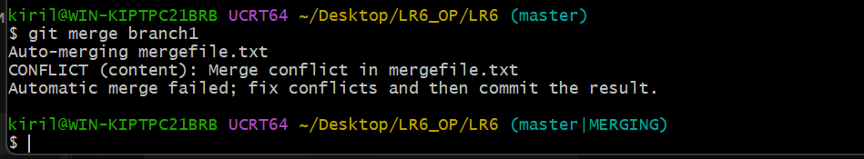

Через `cat mergefile.txt` посмотрел оба варианта текста.
Они были разделены маркерами `<<<<<<<`, `=======` и `>>>>>>>`.

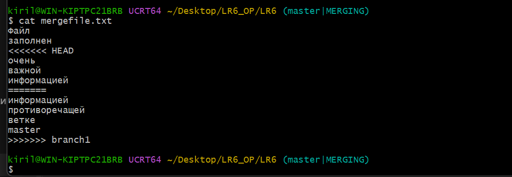

Открыл файл в Блокноте, оставил вариант из `master` и удалил маркеры:

```text
Файл
заполнен
очень
важной
информацией
```

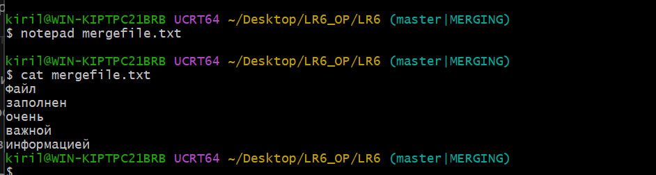

Сохранил файл, выполнил `git add mergefile.txt` и создал коммит.
Слияние завершилось, в истории появился коммит `8591a15`.

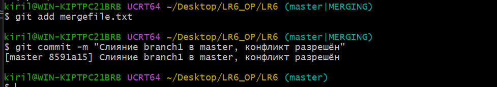

### 6. Удаление ветки

После слияния удалил локальную ветку командой `git branch -d branch1`.
Проверил результат через `git branch` — осталась `master`.

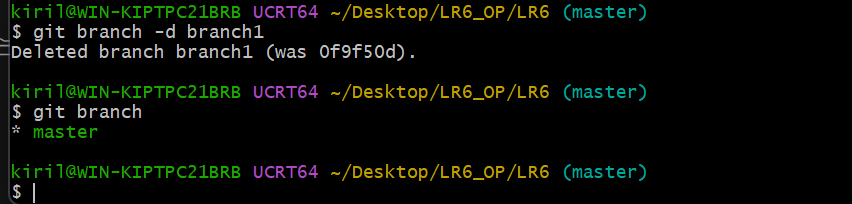

### 7. Изменения и коммиты

Изменил `test.txt` и сохранил изменение командами `git add` и `git commit`.
Получился первый коммит `647d4e8`.

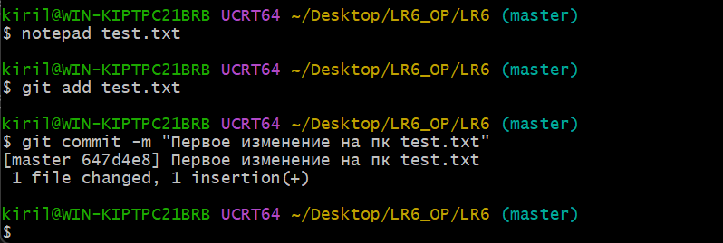

Ещё раз изменил файл и создал второй коммит `9eebd7b`.
Для каждого коммита указал комментарий.

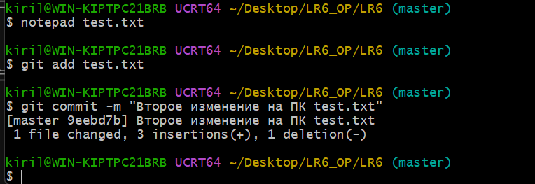

### 8. Откат

Отменил второй коммит командой `git revert --no-edit HEAD`.
Git создал коммит отмены `ea2c32f`, сохранив предыдущие коммиты в истории.

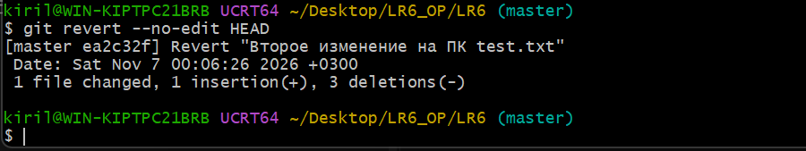

Проверил файл через `cat test.txt`. Осталось первое изменение:

```text
Создан через GitHub
Первое изменение на компьютере
```

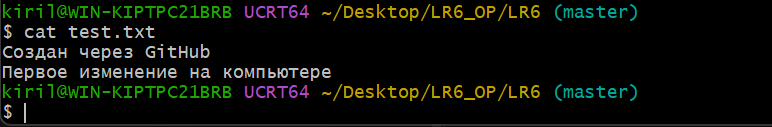

### 9. Оформление отчёта

Создал ветку для отчёта командой `git switch -c report`.

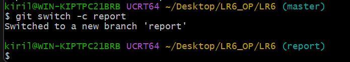

Начал оформлять `README.md` в Markdown и сохранил начало отчёта коммитом `5cd69cf`.

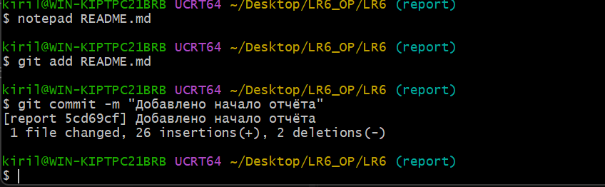

Скриншоты поместил в папку `screenshots`. В отчёт добавил описание работы,
журнал команд и историю коммитов. Полную версию отчёта сохранил отдельным коммитом.

## Журнал команд

```bash
git config --global user.name "4515 Дудкин К.Р."
git config --global user.email "kirill1866kirill@gmail.com"
git clone https://github.com/Kirill866/LR6.git
cd LR6
git pull
git branch -a
git log --all --graph --oneline
git show
git switch branch1
git branch -a
git log --oneline branch1
git log --oneline master
git show master
git switch master
git merge branch1
cat mergefile.txt
notepad mergefile.txt
cat mergefile.txt
git add mergefile.txt
git commit -m "Слияние branch1 в master, конфликт разрешён"
git branch -d branch1
git branch
git config user.name
notepad test.txt
git add test.txt
git commit -m "Первое изменение на пк test.txt"
notepad test.txt
git add test.txt
git commit -m "Второе изменение на ПК test.txt"
git revert --no-edit HEAD
cat test.txt
git switch -c report
notepad README.md
git add README.md
git commit -m "Добавлено начало отчёта"
mkdir -p screenshots
explorer .
ls screenshots
```

## История коммитов

История перед итоговым сохранением отчёта получена в формате
«короткий хэш, дата, автор, комментарий»:

```bash
git log --all --pretty=format:"%h | %ad | %an | %s" --date=short
```

| Хэш | Дата | Автор | Комментарий |
| --- | --- | --- | --- |
| 5cd69cf | 2026-11-07 | 4515 Дудкин К.Р. | Добавлено начало отчёта |
| ea2c32f | 2026-11-07 | 4515 Дудкин К.Р. | Revert "Второе изменение на ПК test.txt" |
| 9eebd7b | 2026-11-07 | 4515 Дудкин К.Р. | Второе изменение на ПК test.txt |
| 647d4e8 | 2026-11-06 | 4515 Дудкин К.Р. | Первое изменение на пк test.txt |
| 8591a15 | 2026-11-06 | 4515 Дудкин К.Р. | Слияние branch1 в master, конфликт разрешён |
| 95da82e | 2026-11-06 | Kirill866 | Добавлен файл через GitHub |
| 921f53b | 2020-11-21 | Kurtyanik | Обновление информации |
| 0f9f50d | 2020-11-21 | Kurtyanik | Заполнил файл |
| c08a654 | 2020-11-21 | Kurtyanik | Файл создан пустым |
| 3c6e913 | 2020-11-21 | Kurtyanik | Initial commit |

Копия истории: [history.txt](history.txt).

## Сохранение и отправка

Команды для финального коммита и отправки веток на GitHub:

```bash
git add README.md screenshots history.txt
git commit -m "Завершён отчёт по лабораторной работе №6"
git push origin master
git push -u origin report
```

Для сдачи подготовлен PDF с титульным листом и ссылкой на репозиторий.

## Вывод

Научился просматривать историю Git, создавать коммиты и работать с ветками.
Во время слияния исправил конфликт вручную. Также попробовал отменить
изменения через `git revert` и оформил отчёт в отдельной ветке.
